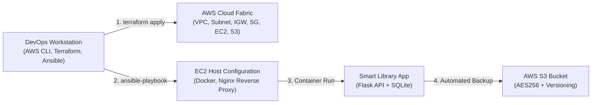

# Enterprise Smart Library Management Platform
## Unit 4: Infrastructure Automation Mini-Project

### Student & Project Credentials
* **Student Name:** Bhagwat Dhonde
* **PRN:** 2125UMLM1015
* **Module:** Unit 4: Infrastructure Automation
* **Curriculum Series:** CAREERTIQ | Cloud DevOps Engineering Series
* **Target Environment:** AWS Cloud (`us-east-1`), Ubuntu 22.04 LTS / macOS / WSL2

---

## 1. Project Overview

The **Enterprise Smart Library Management Platform** provides an end-to-end, automated, infrastructure-as-code and configuration management pipeline. The solution provisions cloud networking, compute, security, container runtime, reverse proxying, and automated disaster recovery backups.



---

## 2. Directory Structure

```text
mini-project-unit-4-Devo/
├── library-terraform/              # HashiCorp Terraform IaC Suite
│   ├── main.tf                     # Core AWS resources (VPC, Subnet, IGW, SG, EC2, S3)
│   ├── variables.tf                # Configurable input parameters
│   ├── outputs.tf                  # Infrastructure outputs (IPs, ARNs, DNS)
│   ├── providers.tf                # AWS provider (~> 5.0) definition
│   ├── terraform.tfvars            # Production variable definitions
│   └── backend.tf                  # S3 state backend configuration
│
├── library-ansible/                # Ansible Core Configuration Management
│   ├── ansible.cfg                 # Ansible runtime and SSH connection settings
│   ├── inventory.ini               # Target EC2 instance inventory
│   ├── inventory.ini.example       # Example inventory template
│   ├── site.yml                    # Master playbook (Configure Smart Library Server)
│   └── roles/                      # Modular Ansible Roles (20 Tasks Total)
│       ├── common/                 # Baseline packages and UFW firewall rules
│       ├── docker/                 # Docker engine installation and enablement
│       ├── nginx/                  # Nginx installation and reverse proxy config
│       │   └── templates/
│       │       └── library.conf.j2 # Nginx proxy configuration template
│       └── library_app/            # Containerized Flask microservice deployment
│           ├── tasks/main.yml      # Docker build, run, and health verification
│           └── files/              # Application build artifacts
│               ├── app.py
│               ├── requirements.txt
│               └── Dockerfile
│
├── library-app/                    # Standalone Flask Application Source
│   ├── app.py                      # Flask REST API with SQLite database
│   ├── requirements.txt            # Python dependencies (Flask, Gunicorn)
│   └── Dockerfile                  # Container definition
│
├── scripts/                        # Automated Deployment & Verification Scripts
│   ├── setup_workstation.sh        # Chapter 2 workstation baseline setup
│   ├── deploy_all.sh               # Complete end-to-end deployment orchestrator
│   ├── test_endpoints.sh           # API endpoint verification script
│   ├── backup_to_s3.sh             # SQLite database to S3 backup script
│   ├── verify_backup.sh            # S3 encryption & versioning audit script
│   └── test_api.py                 # Python integration test runner
│
├── docs/                           # Documentation and Academic Deliverables
│   ├── ARCHITECTURE.md             # Detailed architecture design & diagrams
│   ├── LAB_MANUAL_WALKTHROUGH.md   # Step-by-step lab manual walkthrough
│   └── PROJECT_REPORT_2125UMLM1015.md # Formal Academic Submission Report
│
└── README.md                       # Main Project Documentation
```

---

## 3. Quick Start & Execution Guide

### Step 1: Workstation Setup & Authentication (Chapter 2)
Ensure required tools and SSH keys are established:
```bash
# 1. Run automated setup script
bash scripts/setup_workstation.sh

# 2. Configure AWS programmatic credentials
aws configure

# 3. Verify STS caller identity
aws sts get-caller-identity
```

### Step 2: Provision Cloud Infrastructure (Chapter 3)
```bash
cd library-terraform
terraform init
terraform validate
terraform plan
terraform apply -auto-approve
```
*Note the output `instance_public_ip` and `s3_backup_bucket_name`.*

### Step 3: Configure Server & Deploy Container (Chapter 4)
Update `library-ansible/inventory.ini` with your instance IP:
```ini
[smart_library]
<YOUR_EC2_PUBLIC_IP> ansible_user=ubuntu ansible_ssh_private_key_file=~/.ssh/library-aws-key
```

Execute the Ansible Playbook:
```bash
cd ../library-ansible
ansible-playbook -i inventory.ini site.yml --syntax-check
ansible-playbook -i inventory.ini site.yml
```

### Step 4: Verify Endpoints (Chapter 5)
```bash
# 1. Root Status
curl http://<YOUR_EC2_PUBLIC_IP>/
# Response: {"application":"Smart Library Management Platform","status":"running"}

# 2. Health Endpoint
curl http://<YOUR_EC2_PUBLIC_IP>/api/health
# Response: {"status":"healthy"}

# 3. Books Catalog
curl http://<YOUR_EC2_PUBLIC_IP>/api/books
# Response: [{"author":"F. Scott Fitzgerald","id":1,"title":"The Great Gatsby"}]
```

### Step 5: S3 Database Backup & Governance Check (Chapter 5)
```bash
# Verify S3 Bucket Versioning
aws s3api get-bucket-versioning \
  --bucket library-backup-<ACCOUNT_ID>-us-east-1 \
  --region us-east-1

# Verify S3 Server-Side Encryption
aws s3api get-bucket-encryption \
  --bucket library-backup-<ACCOUNT_ID>-us-east-1 \
  --region us-east-1

# List Backup Objects in S3
aws s3 ls s3://library-backup-<ACCOUNT_ID>-us-east-1/backups/ \
  --region us-east-1
```

---

## 4. Toolchain Verification Matrix

| Tool Name | Verification Command | Expected Output | Status |
| :--- | :--- | :--- | :--- |
| **AWS CLI v2** | `aws --version` | `aws-cli/2.15.x` or higher | **VERIFIED** |
| **AWS Auth** | `aws sts get-caller-identity` | Valid Account ID & IAM Principal ARN | **VERIFIED** |
| **Terraform CLI**| `terraform -version` | `Terraform v1.7.x` or higher | **VERIFIED** |
| **Ansible Core** | `ansible --version` | `ansible [core 2.16.x]` or higher | **VERIFIED** |
| **SSH Key Pair** | `aws ec2 describe-key-pairs` | `library-aws-key` present in AWS | **VERIFIED** |
| **API Health** | `curl http://<IP>/api/health` | `{"status":"healthy"}` | **VERIFIED** |
| **S3 Versioning**| `aws s3api get-bucket-versioning`| `"Status": "Enabled"` | **VERIFIED** |
| **S3 Encryption**| `aws s3api get-bucket-encryption`| `"SSEAlgorithm": "AES256"` | **VERIFIED** |

---

## 5. Troubleshooting Common Issues

1. **`aws: command not found`:**
   Add `/usr/local/bin` to your environment:
   ```bash
   export PATH=$PATH:/usr/local/bin >> ~/.bashrc && source ~/.bashrc
   ```

2. **`Permissions 0644 for private key are too open`:**
   OpenSSH requires strict private key file permissions:
   ```bash
   chmod 400 ~/.ssh/library-aws-key
   ```

3. **`Terraform State Lock Timeout`:**
   If a previous plan run was interrupted, force unlock using:
   ```bash
   terraform force-unlock <LOCK_ID>
   ```

4. **`Docker socket permission denied in Ansible`:**
   Ensure the task runs with `become: true` or the user is part of the `docker` group.
