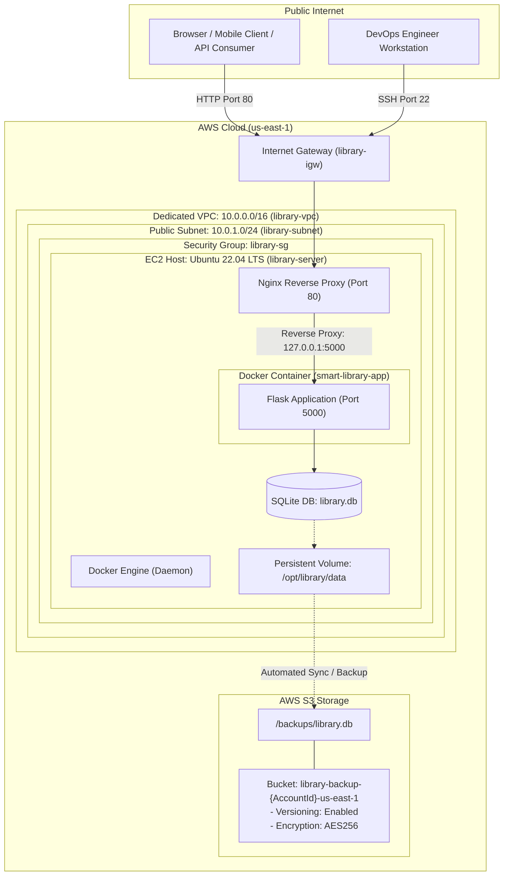

# Architecture Specification: Enterprise Smart Library Management Platform
**Course Module:** Unit 4: Infrastructure Automation  
**Author:** Bhagwat Dhonde  
**PRN:** 2125UMLM1015  

---

## 1. High-Level System Architecture

The Enterprise Smart Library Management Platform is deployed on Amazon Web Services (AWS) using an Infrastructure-as-Code (Terraform) and Configuration Management (Ansible) pipeline.

---

## 2. Component Specifications

### 2.1 Networking Fabric (Terraform)
* **VPC:** `10.0.0.0/16` with DNS hostname and resolution enabled.
* **Subnet:** `10.0.1.0/24` in `us-east-1a` with automatic public IPv4 mapping.
* **Internet Gateway:** Attached to VPC to grant bidirectional internet routing.
* **Route Table:** Default route `0.0.0.0/0` directed to the Internet Gateway.

### 2.2 Security Governance (Security Group)
* **Ingress Port 22 (SSH):** Remote administration for Ansible execution.
* **Ingress Port 80 (HTTP):** Public web traffic routed to Nginx.
* **Ingress Port 5000 (Custom TCP):** Direct application / API access and testing.
* **Egress (All Ports):** Unrestricted outbound access for APT updates, Docker hub pulls, and AWS S3 API calls.

### 2.3 Compute & Container Layer (EC2 & Docker)
* **Host Operating System:** Canonical Ubuntu Server 22.04 LTS (resolved dynamically from AWS SSM Parameter Store).
* **Container Engine:** Docker CE managed by systemd.
* **Application Framework:** Lightweight Python 3.10 Flask microservice running in an isolated Docker container.
* **Persistent Storage:** Docker volume mount from host `/opt/library/data` to container `/opt/library/data`.

### 2.4 Ingress Routing Layer (Nginx)
* **Reverse Proxy:** Listens on port 80 and forwards requests to `http://127.0.0.1:5000`.
* **Headers Injected:** `Host`, `X-Real-IP`, `X-Forwarded-For`, and `X-Forwarded-Proto`.

### 2.5 Disaster Recovery & Storage (Amazon S3)
* **Bucket Naming:** Deterministic naming format `library-backup-${ACCOUNT_ID}-${REGION}`.
* **Versioning:** Enabled to preserve revision history and prevent accidental deletion.
* **Server-Side Encryption:** Mandatory `AES256` encryption at rest.
* **Backup Destination:** S3 path `s3://<bucket-name>/backups/library.db`.
